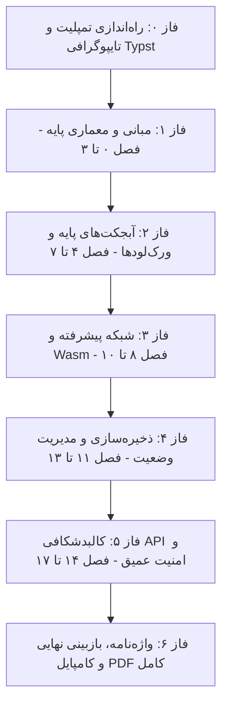

# برنامه‌ریزی جامع ترجمه، تفسیر و تولید کتاب PDF کوبرنتیز (The Kubernetes Book - 2025 Edition)

**کتاب مبنا:** *The Kubernetes Book (2025 Edition)*  
**نویسنده:** نایجل پولتون (Nigel Poulton) با همکاری پوشکار جوگلکار (Pushkar Joglekar)  
**هدف نهایی:** ارائه ترجمه تفسیری، روان و کاملاً بومی‌سازی‌شده به همراه دیاگرام‌ها، نمونه کدها، تفسیر سناریوهای عملیاتی و تولید یک فایل **PDF کامل، نفیس و استاندارد با کیفیت چاپ**.

---

## ۱. استانداردهای نگارش و ترجمه تفسیری

1. **رویکرد تفسیری (Conceptual & Interpretive):**
   - پرهیز کامل از ترجمه کلمه‌به‌کلمه و ماشینی.
   - انتقال شفاف فلسفه و منطق معماری ابزارها و آبجکت‌های کوبرنتیز.
   - تشریح دلایل تصمیم‌گیری‌های مهندسی و الگوهای عملیاتی (Best Practices) متناسب با نسخه ۱.۳۲ کوبرنتیز.

2. **مدیریت اصطلاحات تخصصی (Terminology):**
   - حفظ کلمات کلیدی استاندارد (مانند Pod، Deployment، Service، ConfigMap، Ingress، etcd، Kubelet و...).
   - استفاده از معادل‌های دقیق فارسی در کنار نام اصلی انگلیسی در اولین اشاره.
   - نگارش پانویس‌ها و واژه‌نامه اختصاصی در انتهای کتاب.

3. **زیرساخت صفحه‌آرایی و تولید PDF:**
   - استفاده از موتور صفحه‌بندی مدرن **Typst** با پشتیبانی بومی از راست‌به‌چپ (RTL) و دوزبانه (BiDi).
   - قلم استاندارد فارسی: **وزیزمتن (Vazirmatn)** برای متن روان و زیبا.
   - قالب‌بندی خوانا برای قطعه‌کدهای YAML/Bash، باکس‌های نکته (Note)، هشدار (Warning) و نکات عملیاتی.
   - شماره‌گذاری صفحات، سربرگ، پانویس و فهرست خودکار مطالب.

---

## ۲. فازبندی اجرایی پروژه

---

## ۳. چک‌لیست فازها و سرفصل‌ها

### فاز ۰: زیرساخت فنی و آماده‌سازی قالب PDF
- [x] تست و اعتبارسنجی موتور کامپایلر Typst برای رندرینگ زبان فارسی و RTL
- [x] دانلود و تنظیم فونت‌های استاندارد فارسی (Vazirmatn در انواع وزن‌ها)
- [x] طراحی قالب ساختاری کتاب (صفحه عنوان، صفحه مشخصات، فهرست خودکار، سرصفحه/پاصفحه، کادرهای راهنما)

---

### فاز ۱: مبانی، معماری و استقرار کلاستر
- [x] **فصل ۰: پیش‌گفتار (Preface)**
  - معرفی نسخه ۲۰۲۵، تغییرات اکوسیستم، مخزن نمونه‌کدها
- [x] **فصل ۱: الفبای کوبرنتیز (Kubernetes Primer)**
  - تاریخچه، فلسفه پیدایش و چرا کوبرنتیز سیستم‌عامل ابری نامیده می‌شود؟
- [x] **فصل ۲: اصول بنیادین کارکرد کوبرنتیز (Principles of Operation)**
  - نمای ۴۰ هزار پایی، معماری Control Plane در برابر Worker Nodes، مدل اعلانی (Declarative) و مغایرت‌یابی حالت مطلوب (Desired State)
- [x] **فصل ۳: راه‌اندازی و دسترسی به کلاستر (Getting Kubernetes)**
  - راه‌اندازی محیط‌های توسعه (Docker Desktop، Minikube، کلاسترهای ابری)، پیکربندی `kubectl` و درک `kubeconfig`

---

### فاز ۲: هسته پردازشی و آبجکت‌های اصلی
- [x] **فصل ۴: کار با پادها (Working with Pods)**
  - تئوری عمیق پاد، ساختار چندکانتینری، سایدکار بومی (Native Sidecars)، کانتینرهای Init و چرخه حیات پاد
- [x] **فصل ۵: کلاسترهای مجازی با نیم‌اسپیس‌ها (Namespaces)**
  - فلسفه جداسازی منابع، نام‌گذاری، سهمیه‌ها (Resource Quotas) و سناریوهای چندمستأجری (Multi-tenancy)
- [x] **فصل ۶: دیپلویمنت‌ها و ارتقای بدون قطعی (Deployments)**
  - مدیریت پادها در اسکیل بالا، اسکیل دستی و خودکار (Scaling)، الگوریتم Rolling Update و مدیریت رول‌بک (Rollback)
- [x] **فصل ۷: سرویس‌های کوبرنتیز و شبکه پایدار (Services)**
  - مدل شبکه پادها، چرا سرویس‌ها ضروری هستند؟، انواع Service (ClusterIP, NodePort, LoadBalancer) و معماری kube-proxy

---

### فاز ۳: شبکه پیشرفته، Wasm و سرویس دیسکاوری
- [x] **فصل ۸: مدیریت هوشمند ورودی با اینگرس (Ingress)**
  - حل مسئله ترافیک لایه ۷، معماری Ingress Controller و قوانین مسیریابی HTTP/HTTPS
- [x] **فصل ۹: وب‌اسمبلی در کوبرنتیز (Wasm on Kubernetes)**
  - مبانی WebAssembly، اجرای ورک‌لودهای بدون کانتینر در کوبرنتیز با Wasm runtimes
- [x] **فصل ۱۰: کالبدشکافی عمیق سرویس دیسکاوری (Service Discovery Deep Dive)**
  - مکانیزم داخلی CoreDNS، Service Registry، رجیستریشن سرویس‌ها و خطایابی ترافیک شبکه و دامنه‌ها در کلاستر

---

### فاز ۴: ذخیره‌سازی، پیکربندی و برنامه‌های دارای وضعیت
- [x] **فصل ۱۱: سیستم ذخیره‌سازی در کوبرنتیز (Storage Subsystem)**
  - معماری CSI، بررسی مفاهیم PV ،PVC و StorageClass و سناریوهای Dynamic Provisioning
- [x] **فصل ۱۲: مدیریت پیکربندی و داده‌های حساس (ConfigMaps & Secrets)**
  - تزریق کانفیگ‌ها به محیط اجرا، روش‌های امن‌سازی Secrets، محدودیت‌ها و الگوهای مدرن مدیریت کلیدها
- [x] **فصل ۱۳: برنامه‌های دارای وضعیت با استیت‌فول‌ست (StatefulSets)**
  - تفاوت StatefulSet با Deployment، هویت پایدار پادها (Stable Network ID & Storage)، ترتیب روشن/خاموش شدن و الگوهای پایگاه داده در کوبرنتیز

---

### فاز ۵: معماری عمیق API و امنیت پیشرفته
- [x] **فصل ۱۴: امنیت API و کنترل دسترسی نقشی (API Security & RBAC)**
  - زنجیره ۳ مرحله‌ای امنیت API: احراز هویت (Authentication)، مجازشماری (RBAC)، و کنترل پذیرش (Admission Controllers)
- [x] **فصل ۱۵: کالبدشکافی سرور API کوبرنتیز (The Kubernetes API)**
  - معماری داخلی kube-apiserver، منابع اعلانی، کاستوم ریسورس‌ها (CRDs) و اکستنشن‌پذیری کوبرنتیز
- [x] **فصل ۱۶: مدل‌سازی تهدیدات در کوبرنتیز (Threat Modeling)**
  - چارچوب امنیتی STRIDE بر روی تک‌تک اجزای کلاستر، خطرات ترفیع دسترسی و کاهش سطح حمله
- [x] **فصل ۱۷: امنیت کاربردی در دنیای واقعی (Real-World Security)**
  - ایزولاسیون بار کاری (Workload Isolation)، امنیت در پایپ‌لاین CI/CD، مانیتورینگ و آدیت امنیتی در پروداکشن

---

### فاز ۶: جمع‌بندی، واژه‌نامه تخصصی و ساخت فایل PDF نهایی
- [x] **فصل ۱۸: واژه‌نامه تخصصی اصطلاحات کوبرنتیز (Glossary & Terminology)**
- [x] **فصل ۱۹: بخش پایانی و منابع (Outro & References)**
- [x] **یکپارچه‌سازی، فهرست‌بندی و بازبینی نگارشی کل کتاب**
- [x] **کامپایل فایل PDF کامل و نهایی کتاب به زبان فارسی (`The-Kubernetes-Book-2025-Persian.pdf`)**
